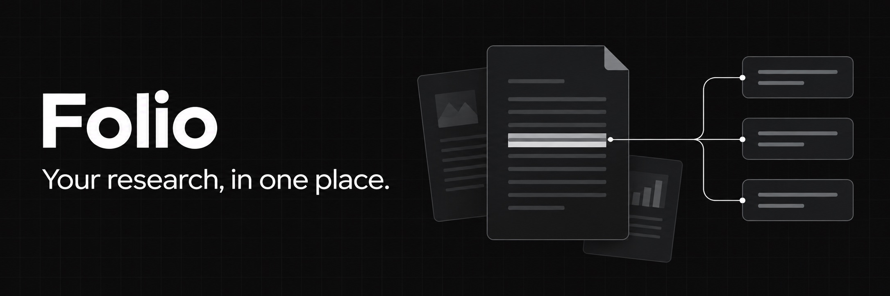

# Folio

[عربي](README.md) · **English**

*Every source, every note, one folio.*

Folio is a free research workspace for students. Collect your sources, read and highlight them, take notes, keep your references, and think your project through with the AI model of your choice.

**The AI never writes your paper.** It asks questions, explains, points you to the right page and gives feedback on your writing. The writing stays yours.

It runs on your own computer, opens in your browser, and keeps your files with you.

## What it does

- **Sources**: PDFs, Word files, web pages, YouTube videos and text, each with its own note beside it.
- **Highlights**: highlight PDFs; quotes are saved with a link back to the page.
- **Chat**: ask about one source or all of them; answers cite the page.
- **Search** (`Ctrl/⌘ K`): across every source and note, offline.
- **References**: add by DOI, BibTeX or title; export in any style (APA, IEEE, Harvard…).
- **Find papers**: search OpenAlex, Semantic Scholar and arXiv; add a paper with its free PDF in one click.
- Also: literature matrix, thesis plan, writing feedback, a check for wording copied from your sources, a tracker for your supervisor's comments, version history and automatic backups, idea canvas, LaTeX editor, and export to Word and PDF.

## Install (once)

Nothing else to install first.

**Mac or Linux**: open **Terminal**, paste this line and press Enter:

```bash
curl -fsSL https://raw.githubusercontent.com/akamoe/research-platform/main/scripts/install.sh | bash
```

**Windows**: open **PowerShell** from the Start menu, paste this line and press Enter:

```powershell
irm https://raw.githubusercontent.com/akamoe/research-platform/main/scripts/install.ps1 | iex
```

The first time takes a few minutes. Then Folio opens in your browser and you get a **Folio** icon like any other app: in Launchpad and Spotlight on a Mac (drag it to the Dock), or on the Desktop and in the Start menu on Windows.

## Start your first project

1. Open **Folio** from its icon and create a project for your research.
2. Select **+** next to **Sources** to add a PDF, Word file, web page, YouTube video, or text. You can also drag files into the window.
3. Open a source to read it and write notes beside it. Highlight text in a PDF to save a quote and return to its page later.
4. Use **Find papers** to search for research. In **References**, add references by DOI, title, or BibTeX, then copy or export them in your preferred style.
5. Write in **Notes**, organize chapters in **Thesis**, and compare sources in the **Literature matrix**. Export a note to Word or PDF when you need it.

Press `Ctrl/⌘ K` to search your sources and notes. See the [full guide](docs/GUIDE.md) for more details.

## Use AI

To use chat and other AI features, open **Settings** and add an API key from OpenAI, Anthropic, OpenRouter, or OpenCode Go. AI features need an internet connection, and your provider may charge for usage. The rest of the app works without an API key.

Open **Chat** to ask questions about your sources. Select a citation to return to the source, and check the answer yourself. The assistant helps you understand and review your work; you write the paper.

## Your files and updates

- **Back up your work:** Copy the `ResearchPlatform` folder in your home folder.
- **Privacy:** Folio runs on your computer. When you use AI, the relevant text is sent to your chosen provider.
- **Internet:** AI, paper and reference searches, and fetching web pages and YouTube videos need a connection. Search within your sources and notes works offline.
- **Update:** Run the same install command again. Your projects stay in place.
- **Running in the background:** Folio stays open until you shut down your computer.

## Contribute

Fixes and new features are welcome. Read [CONTRIBUTING.md](CONTRIBUTING.md) first.

```bash
git clone https://github.com/akamoe/research-platform.git
cd research-platform
npm ci
npm run dev        # API server on :5174 + Vite on :5173 with hot reload
npm run folio      # start Folio the way students do
npm run shortcut   # make a Folio app icon for this copy
```

## Credits

Theme presets in `src/lib/tweakcn-presets.json` come from [tweakcn](https://github.com/jnsahaj/tweakcn) (Apache-2.0).
