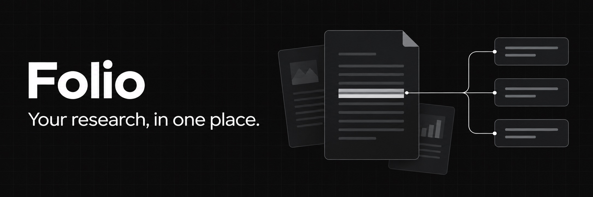

<div dir="rtl">

# Folio

**عربي** · [English](README.en.md)

*كل مصادرك وملاحظاتك بمكان واحد.*

‏Folio برنامج مجاني للطلاب اللي دا يكتبون بحث أو رسالة. بيه تجمع مصادرك، تقرا وتظلل، تكتب ملاحظاتك، ترتب مراجعك، وتناقش بحثك ويه الذكاء الاصطناعي.

**الذكاء الاصطناعي ما يكتب بحثك أبداً.** يسألك، يشرحلك، يدلّك على الصفحة الصح، ويعطيك ملاحظات على كتابتك. بس الكتابة تبقى إلك.

يشتغل على حاسبتك وينفتح بالمتصفح، وملفاتك تبقى عندك.

## شنو يسوي

- **المصادر**: PDF و Word وصفحات ويب وفيديوهات يوتيوب ونصوص، وكل مصدر يمّه ملاحظة.
- **التظليل**: ظلل بالـ PDF، والاقتباس ينحفظ ويه رابط يرجعك لنفس الصفحة.
- **الشات**: اسأل عن مصدر واحد أو عن كل مصادرك، والجواب يذكرلك الصفحة.
- **البحث** (`Ctrl/⌘ K`): يدور بكل مصادرك وملاحظاتك، حتى بدون انترنت.
- **المراجع**: ضيفها بالـ DOI أو BibTeX أو العنوان، وطلّعها بأي ستايل (APA و IEEE و Harvard...).
- **دوّر على بحوث**: من OpenAlex و Semantic Scholar و arXiv، وضيف البحث ويه الـ PDF المجاني بضغطة وحدة.
- **للكتابة**: ملاحظات بروابط `[[...]]` وسجل نسخ، ملاحظة وحدة لعدة بحوث، محرر LaTeX ويه قوالب مجلات و SyncTeX، مخططات وجداول من بياناتك، وتصدير لـ Word و PDF.
- **للتنظيم**: خطة الرسالة ومواعيدها، مصفوفة الأدبيات، قائمة قراءة، متابعة تعليقات المشرف، و Canvas للأفكار.
- **للمراجعة**: ملاحظات على كتابتك، فحص النص المنقول من مصادرك، بطاقات مراجعة من تظليلاتك، وقراءة الـ PDF الممسوح (OCR).
- **للتركيز**: مؤقّت بومودورو ومشغّل موسيقى للدراسة.
- **للأمان**: نسخ احتياطي يومي تلقائي واسترجاع.

## يغنيك عن

ما يعوّضهم بالكامل، بس يگدر يقوم بشغلهم بمكان واحد:

- **Zotero / Mendeley / EndNote**: المراجع وأنماط التوثيق
- **Google Scholar / Semantic Scholar / Connected Papers**: البحث عن الأوراق والأوراق المرتبطة والـ PDF المجاني
- **Overleaf / TeXstudio**: LaTeX ويه قوالب ومعاينة PDF و SyncTeX
- **NotebookLM / ChatPDF / Elicit**: الشات ويه بحوثك ويه استشهادات وملخصات
- **Readwise / RemNote / Acrobat**: تظليل الـ PDF مربوط بالملاحظات، و OCR للملفات الممسوحة
- **Obsidian / Notion**: ملاحظات Markdown وروابط وسجل نسخ
- **Miro / Heptabase**: Canvas للأفكار ويه رسم وأسهم
- **Excel (مراجعة الأدبيات) / Datawrapper**: مصفوفة الأدبيات، ومخططات وجداول من CSV
- **Grammarly / Turnitin (فحص ذاتي)**: ملاحظات على الكتابة وفحص التشابه ويه مصادرك
- **Trello / مخطط Notion / تعليقات Word**: خطة الرسالة، المواعيد، وتعليقات المشرف
- **Anki / Quizlet**، **Pocket**، **Forest / Pomofocus**، **Spotify للتركيز**: بطاقات مراجعة، قائمة قراءة، بومودورو، وموسيقى
- **Time Machine / Dropbox**: نسخ احتياطي يومي واسترجاع

## التنصيب (مرة وحدة)

ما تحتاج تنصّب أي شي قبله.

**ماك (Apple Silicon)**: الأسهل تنزّل **Folio for Mac** من [صفحة الإصدارات](https://github.com/akamoe/research-platform/releases/latest)، تفتح ملف الـ `.dmg` وتسحب Folio لـ Applications. أول مرة تفتحه شوف [Folio for Mac](docs/GUIDE.ar.md#folio-for-mac).

**أو بالماك من Terminal**: افتح برنامج **Terminal** (دوره بـ Spotlight)، الصق هذا السطر ودوس Enter:

</div>

```bash
curl -fsSL https://raw.githubusercontent.com/akamoe/research-platform/main/scripts/install.sh | bash
```

<div dir="rtl">

**ويندوز**: افتح **PowerShell** من قائمة Start، الصق هذا السطر ودوس Enter:

</div>

```powershell
irm https://raw.githubusercontent.com/akamoe/research-platform/main/scripts/install.ps1 | iex
```

<div dir="rtl">

(لينكس نفس سطر الماك.)

أول مرة ياخذ كم دقيقة، وبعدها Folio ينفتح بالمتصفح وتصير عندك أيقونة **Folio** مثل أي برنامج:

- **ماك**: بـ Launchpad أو Spotlight، وتگدر تسحبها للـ Dock.
- **ويندوز**: على سطح المكتب وبقائمة Start.

## ابدي بمشروعك

1. افتح **Folio** من الأيقونة وسوّي مشروع جديد لكل بحث تشتغل عليه.
2. اضغط **+** جنب **Sources** وضيف ملف PDF أو Word، رابط صفحة ويب أو فيديو YouTube، أو نص. تگدر هم تسحب الملفات وتفلتها بالنافذة.
3. افتح المصدر واقراه. ظلّل النص بالـ PDF حتى تحفظ اقتباس وترجع للصفحة، واكتب ملاحظاتك يمّه.
4. افتح **Find papers** حتى تبحث عن بحوث، أو **References** حتى تضيف مراجعك بالـ DOI أو العنوان أو BibTeX. تگدر تنسخ قائمة المراجع أو تصدّرها بالنمط اللي تحتاجه.
5. اكتب أفكارك بـ **Notes**، واستخدم **Thesis** لترتيب فصولك، أو **Literature matrix** حتى تقارن بين مصادرك. من الملاحظة تگدر تصدّر شغلك إلى Word أو PDF.

للبحث بكل المصادر والملاحظات، اضغط `Ctrl/⌘ K`. ولتفاصيل أكثر عن كل ميزة، شوف [دليل الاستخدام](docs/GUIDE.ar.md).

## استخدام الذكاء الاصطناعي

إذا تريد تستخدم الشات أو ميزات الذكاء الاصطناعي، افتح **Settings** وأضف مفتاح API من OpenAI أو Anthropic أو OpenRouter أو OpenCode Go. ميزات الذكاء الاصطناعي تحتاج إنترنت، وقد يفرض المزوّد رسومًا حسب استخدامك. باقي أدوات التطبيق ما تحتاج مفتاح.

افتح **Chat** واسأل عن مصادرك؛ تگدر تضغط على الاستشهاد حتى ترجع للمكان بالمصدر. راجع الإجابات والصفحات بنفسك. المساعد يساعدك تفهم وتراجع، وكتابة البحث تبقى إلك.

## ملفاتك

- **ملفاتك** محفوظة بفولدر `ResearchPlatform` داخل مجلد المستخدم على حاسبتك. حتى تسوي نسخة احتياطية، انسخ الفولدر.
- **الخصوصية**: التطبيق يشتغل على جهازك. عند استخدام الذكاء الاصطناعي، النص المطلوب ينرسل للمزوّد اللي اخترته.
- **الإنترنت** مطلوب للذكاء الاصطناعي والبحث عن الأوراق والمراجع وجلب روابط الويب وYouTube. البحث داخل مصادرك وملاحظاتك يشتغل بدون إنترنت.
- **التشغيل**: Folio يبقى شغال بالخلفية لحد ما تطفي الحاسبة.

## التحديث

- **من داخل Folio**: **Settings ← Check for updates ← Update now**. يتحدّث ويرجع يشتغل بروحه، ومشاريعك تبقى بمكانها.
- **أو** شغّل نفس سطر التنصيب مرة ثانية.
- **إذا نصّبته بـ git** (للمطورين):

</div>

```bash
cd research-platform
git pull origin main && npm ci && npm start
```

<div dir="rtl">

- إذا `git pull` رفض لأن عندك تعديلات: شغّل `git stash` وعيد.
- إذا قال المنفذ 5174 مشغول، يعني نسخة قديمة بعدها شغالة. بالماك ولينكس شغّل `lsof -ti :5174 | xargs kill`، وبالويندوز طفّي الحاسبة وشغلها.

## تريد تساهم؟

نرحب بأي تعديل أو ميزة جديدة. اقرا [قواعد المساهمة](CONTRIBUTING.md) قبل لا تبدي.

للمطورين:

</div>

```bash
git clone https://github.com/akamoe/research-platform.git
cd research-platform
npm ci
npm run dev        # السيرفر على :5174 و Vite على :5173
npm run folio      # يشغّل Folio مثل ما يشغله المستخدم
npm run shortcut   # يسوي أيقونة Folio لهذي النسخة
```

<div dir="rtl">

## شكر

ثيمات `src/lib/tweakcn-presets.json` من [tweakcn](https://github.com/jnsahaj/tweakcn) (Apache-2.0).

</div>
